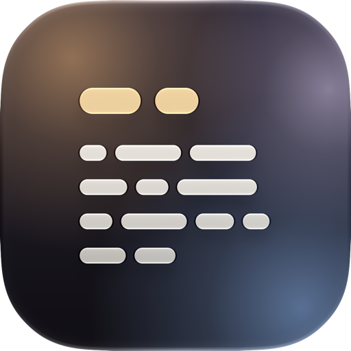
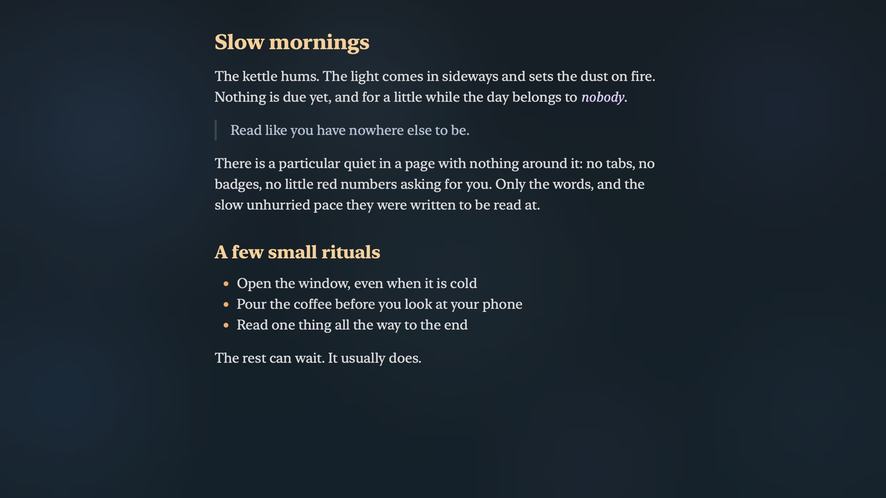

<p align="center">
  
</p>

<h1 align="center">Zenread</h1>

<p align="center">A quiet place to read text on your Mac.</p>



Zenread opens a text or Markdown file, or whatever is on your clipboard, as a
single column of serif type over a blur of your desktop. It has no toolbar,
tabs or sidebar. Read the text, then press Esc to close it.

## Install

You need an Apple silicon Mac running macOS 14 or later, and the Xcode Command
Line Tools (`xcode-select --install`).

```
git clone https://github.com/cottongeeks/zenread && cd zenread
make install
```

This puts **Zenread** in `/Applications` and a `zenread` command in `~/bin`
(add it to your `PATH` if it isn't there already). `make uninstall` removes
both.

## Use

From the terminal:

```
zenread notes.md                          # read a file
zenread                                   # read the clipboard
curl -sL example.com/post.md | zenread -  # read standard input
zenread --plain draft.txt                 # plain text, with hard-wrapped lines joined
zenread --font Charter book.md            # any installed font
```

Without a terminal, open Zenread from Spotlight, the Dock or a launcher hotkey
to read your clipboard, or right-click a file in Finder and choose
**Open With → Zenread**.

Markdown appears as GitHub renders it. The small `</>` icon in the top-right
corner switches to the source text, with its syntax highlighted.

## Keys

| Key | Action |
| --- | --- |
| `Esc` | Close |
| `Space` / `Shift-Space` | Page down / up |
| `↓` `↑` or `j` `k` | Scroll a line |
| `g` / `G` | Top / bottom |
| `⌘+` / `⌘-` | Bigger / smaller text |
| `⌘C`, `⌘A` | Copy, select all |

`PgDn`/`PgUp`, `f`/`b`, `d`/`u`, `Home`/`End` and `⌘↑`/`⌘↓` work too.
